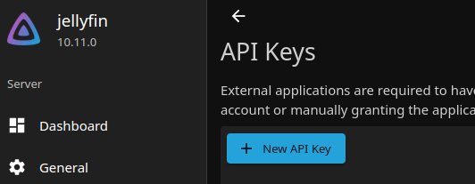
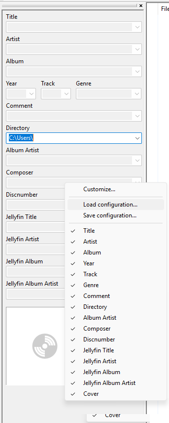
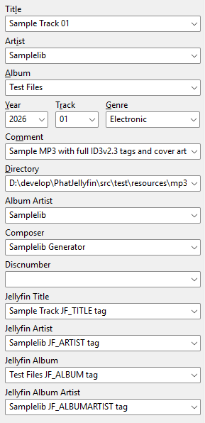

# PhatJellyfin

> "Because your Jellyfin deserves proper metadata too."

A Jellyfin CLI music tag importer for people who need to preserve old tags without accents and modern media servers without going nuts.

### What does this program do?
PhatJellyfin reads custom metadata from your music files and imports it into Jellyfin, while leaving the original tags untouched.

### Why?

Well, I own an old Kenwood car audio head with a Phatnoise cartridge, in fact an ultra-ata HDD (A 160Gb Samsung disc in place of the
original 10Gb HDD shipped originally, which mimics a CD loader. It's a  really cool gadget and, in my humble opinion, far better than
a Spotify subscription or a pendrive as it packages a lot of features.

The downside is that is a not internationalized device so any non-english character like accented vowels, the spanish _ñ_ 
or german umlaut is replaced by am ugly blank space. My approach was to replace any of those with the ascii approach, so
the _ñ_ became _n_ or the _ö_ became _o_, and so on. It's great for the Kenwood but a pity to see in your Jellyfin managed 
library.

That's it. The reason behind this program is: _"Because your Jellyfin deserves proper metadata too."_

## How to use it

This section walks you through using `PhatJellyfin` alongside Mp3tag, a popular tag editor for Windows. I've been using it for years, and it offers plenty of useful features.

### Installation
The executables available for download from each release are portable and do not require installation.

Simply extract the ZIP or 7z archive (depending on your operating system) to the folder of your choice. You can then add that folder to your system's PATH environment variable to run PhatJellyfin from any command-line terminal.

**Note**: It's recommended to extract the application to a folder within your user profile to avoid potential permission issues. 

### The _phatjellyfin.cfg.json_ file

First, let's take a look at the configuration file. PhatJellyfin automatically creates it in the program's directory the first time you run the application, if the file does not already exist.

The default configuration looks like this:

```json
{
  "serverData" : {
    "url" : "http://localhost:8096/",
    "apiKey" : null
  },
  "metadata" : {
    "ALBUM" : "JF_ALBUM",
    "ARTIST" : "JF_ARTIST",
    "TITLE" : "JF_TITLE",
    "ALBUM_ARTIST" : "JF_ALBUMARTIST"
  }
}
```
#### serverData section
The `serverData` object contains your Jellyfin server URL and API key.

If Jellyfin is running on the same machine, you can usually leave the default URL unchanged. Otherwise, replace it with the address of your Jellyfin server.

To generate an API key, open Jellyfin and go to Dashboard → API Keys (or Settings → API Keys, depending on your interface). Create a key and copy it into the apiKey field.



**Keep your API key private**. Do not share your personal configuration file or publish it with a real API key.

#### metadata section
This object maps standard Jellyfin metadata fields to the tag names you want Phat Jellyfin to use as their source.

By default, PhatJellyfin uses the `JF_` tags shown above. You can change these names to match your own tagging conventions.

### Custom tags in Mp3tag
To add these custom tags to Mp3tag, use the `Load configuration...` option in the context menu.



Import the [custom tags configuration](.readme_res/Jellyfin_custom_tags.ini) file or simply add the tag using the `Customize...` option.

Once configured, you can assign values to these custom tags in Mp3tag. 
PhatJellyfin will use those values to update the corresponding metadata fields in Jellyfin, instead of using the standard tags.



For example, the screenshot above shows a track whose original title is `Sample Track 01`, while its **JF_TITLE** tag contains `Sample Track JF_TITLE tag`. 
When you apply the changes with PhatJellyfin, the title displayed in Jellyfin will be `Sample Track JF_TITLE tag`, while the original TITLE tag remains 
unchanged in the audio file.

Now imagine changing `Motorhead` to `Motörhead` in Jellyfin while keeping the original, accent-free value available for an older system 
that doesn't handle special characters properly. Pretty neat, isn't it?

### PhatJellyfin usage
PhatJellyfin is a command-line application. Its general syntax is:

```text
phatjellyfin [options] <folders>
```

`<folders>` is one or more source folders containing your music files. You can specify multiple folders in the same command, and use `--recursive` to include their subfolders.

#### Options

| Option                          | Description                                                                                     |
|---------------------------------|-------------------------------------------------------------------------------------------------|
| `-a`, `--apply`                 | Apply changes to Jellyfin without asking for confirmation.                                      |
| `-l`, `--logLevel`              | Set the logging level: `OFF`, `TRACE`, `DEBUG`, `INFO`, `WARN`, or `ERROR`. Defaults to `INFO`. |
| `-r`, `--recursive`             | Scan source folders recursively, including their subfolders.                                    |
| `-h`, `--help`, `-u`, `--usage` | Display the command-line help.                                                                  |

#### Examples

Display the available options:

```powershell
phatjellyfin --help
```

Scan a music folder and its subfolders:

```powershell
phatjellyfin --recursive "D:\Music"
```

Scan multiple folders:

```powershell
phatjellyfin --recursive "D:\Music\Artist A" "D:\Music\Artist B"
```

Apply the changes to Jellyfin without asking for confirmation:

```powershell
phatjellyfin --recursive --apply "D:\Music"
```

**Warning:** The `--apply` option applies changes directly to Jellyfin without prompting for confirmation. Run PhatJellyfin without this option first if you want to review the proposed changes.

**Note:** 
When `--recursive` (or `-r`) is enabled, if one of the specified folders is a subfolder of another specified folder, only the parent folder is scanned. This prevents the same files from being scanned more than once.

For example:
```powershell
phatjellyfin --recursive "D:\Music\Some Artist" C:\Temp D:\Music
```

In this example, only `C:\Temp` and `D:\Music` will be scanned, since `D:\Music\Some Artist` is already included in the recursive scan of `D:\Music`.